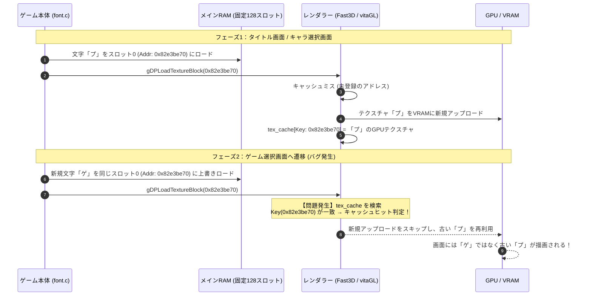

# レトロゲーム（N64等）ネイティブ移植における日本語版ROM対応技術ガイド

本ドキュメントは、N64をはじめとするレトロゲームのPC / PS Vita等へのネイティブソースコード移植（Decompilation移植）において、**英語版専用として実装されているプロジェクトを日本語版ROMに対応させるための技術的知見・アーキテクチャ上の落とし穴・調査デバッグ手法**をまとめた技術資料です。

---

## 目次

1. [背景：欧米版と日本語版の根本的なアーキテクチャ差](#1-背景欧米版と日本語版の根本的なアーキテクチャ差)
2. [【最重要】動的フォントキャッシュとGPUレンダラーの不整合（Stale Texture Cache Hit）](#2-最重要動的フォントキャッシュとgpuレンダラーの不整合stale-texture-cache-hit)
3. [アセットテーブルおよび構造体の地域差](#3-アセットテーブルおよび構造体の地域差)
4. [文字エンコーディングとテキストパーサーの修正](#4-文字エンコーディングとテキストパーサーの修正)
5. [調査・デバッグの体系的アプローチ](#5-調査デバッグの体系的アプローチ)
6. [他タイトル移植への応用チェックリスト](#6-他タイトル移植への応用チェックリスト)

---

## 1. 背景：欧米版と日本語版の根本的なアーキテクチャ差

N64実機（RCP/RDP）のテクスチャメモリ（TMEM）はわずか **4 KB** しかありません。この過酷なハードウェア制約のため、欧米版と日本語版ではテキスト描画の設計が根本から異なります。

| 項目 | 欧米版（US / EU） | 日本語版（JPN） |
| :--- | :--- | :--- |
| **文字種** | 96〜100文字程度（英大小文字・数字・記号） | 数百〜数千文字（ひらがな・カタカナ・漢字・記号） |
| **テクスチャ管理** | **静的アトラス方式**<br>数枚の大きなフォント画像に全文字を並べ、起動時/シーン開始時に一度ロード。 | **動的ストリーミングスロット方式（LRUキャッシュ）**<br>RAM上に固定スロット配列を確保し、画面に出現した文字だけをROMから動的ロード。 |
| **文字コード** | 1バイト ASCII | 2バイト（Shift-JIS、EUC、または作品独自の独自コード） |
| **GPU転送頻度** | シーン初期化時に1度だけ転送 | 画面遷移やダイアログ表示のたびに頻繁に転送・上書き |

この**「日本語版特有の動的文字ストリーミング機構」**が、PCやPS Vita向けのモダンGPUラッパー（Fast3D、OpenGL、vitaGL等）の最適化設計と真っ向から衝突します。

---

## 2. 【最重要】動的フォントキャッシュとGPUレンダラーの不整合（Stale Texture Cache Hit）

### 発生する現象
- タイトル画面の「スタート」「オプション」などは正常に表示される。
- しかし、ゲーム選択画面やセーブデータ選択画面に進むと、**「文字数や表示座標は合っているのに、文字の画像が以前の画面で使われた文字（プレイヤーセレクト、OK?、チャレンジ等）に化けて順番に表示される」**という奇妙なバグが発生する。

### 根本メカニズム（なぜ起こるのか）



1. **ゲーム側**:
   - RAM上に確保した128個のスロット配列（例: `0x82e3be70` など）を使い回す。
   - 古くなった文字スロットを解放（aging）し、新しい文字（「ゲ」など）のピクセルデータを同じRAMアドレスに直接上書きする。
   - この際、通常のヒープ解放（`mempool_free` や `free`）は呼ばれず、**固定バッファへの生メモリ上書き**となる。
2. **モダンレンダラー側（Fast3D / vitaGL）**:
   - 描画負荷を抑えるため、CPU側のテクスチャデータアドレス（`key.addr`）をキーとしてGPUテクスチャをキャッシュ（`tex_cache`）する。
   - 「通常のゲームアセット（背景・カート等）はRAMから解放されない限り内容は変わらない」という前提で作られている。
3. **結果**:
   - RAMアドレスが変わらないため、レンダラーは**「すでにアップロード済みのテクスチャだ」と誤認（Stale Hit）**。
   - GPUに最新ピクセルが再転送されず、古い文字のGPUテクスチャがそのまま使い回されてしまう。

### 解決策・実装パターン

グリフをROMからRAMスロットに読み込んだ直後、およびフォントバッファ初期化時に、**該当スロットのアドレス範囲を明示的にテクスチャキャッシュから破棄（Invalidate）**します。

```c
// font.c: 文字スロット割り当て処理 (func_800C68CC_C74CC 等)

// 1. スロットの以前の割り当てサイズを考慮して破棄範囲を計算
s32 oldSlots = (u8) (*slotTable)[curIndex].slotCount;
s32 slotsToInvalidate = (oldSlots > newSlots) ? oldSlots : newSlots;

// 2. ROMから新しいグリフデータをRAMスロットにロード
asset_load(ASSET_JAPANESE_FONTS, (uintptr_t)asset, ...);

#ifdef NATIVE_PORT
// 3. エンディアン変換
swap_japanese_font_char(asset);

// 4. 【決定打】上書きされたRAM領域のGPUテクスチャキャッシュを即座に無効化
gfx_dkr_texcache_invalidate_range(asset, slotsToInvalidate * SLOT_STRIDE_BYTES);
#endif

// 5. 新しいテクスチャロード用のDisplay Listを作成
fontCreateDisplayList(...);
```

> [!IMPORTANT]
> **スロットサイズの跨ぎに注意**
> 大フォント（例: 8スロット消費）が使われていた領域に、後から小フォント（例: 1スロット消費）が割り当てられる場合、小フォントのサイズ分だけ破棄すると残りの7スロット分に古いマスク画像などが残留します。必ず `max(oldSlots, newSlots)` の範囲を破棄するのがベストプラクティスです。

---

## 3. アセットテーブルおよび構造体の地域差

日本語版ROMを読み込ませる際、欧米版のテーブル読み込みロジックをそのまま通すとオフセットが破綻します。

### よくある差分パターン
1. **言語インデックスの構成**
   - 欧米版: 英語(0), ドイツ語(1), フランス語(2) など複数言語のオフセットテーブル。
   - 日本語版: 言語は日本語のみ。テーブルの先頭要素が言語数ではなく文字列数になっていたり、スロット番号が固定（スロット1または4など）になっている。
   - **対策**: テーブル長（`tableWords`）と各スロットのペイロードサイズを起動時にチェックし、有意な文字列が存在するスロットを自動選択するガードを設ける。
2. **エンディアン変換（Big-Endian → Little-Endian）**
   - N64のROMデータはすべてビッグエンディアン（BE）。
   - 32-bit値・16-bit値はスワップが必要だが、**「1バイトのフラグやパディングが混在する構造体」を安易に32-bit単位でスワップするとバイト順が破壊される**。
   - 例（DKRのキャラクターヘッダー 16バイト）:
     - `s32 ptr` (0x00..0x03): 32-bitスワップ必要
     - `s32 unk4` (0x04..0x07): 32-bitスワップ必要
     - `u8 pad[2], left, top, right, bottom, spacing, pad` (0x08..0x0F): **各1バイト値なのでスワップ厳禁**

---

## 4. 文字エンコーディングとテキストパーサーの修正

### 2バイト文字境界と特殊コード
欧米版移植コードは `char *` を1バイトずつ走査する前提で書かれています。

1. **文字走査ループの修正**
   ```c
   // 日本語文字判定（最上位ビットが立っている場合など）
   if (currentChar & 0x80) {
       char nextChar = *input++;
       // 2バイトを結合して文字IDを復元
       u16 glyphId = (u8)nextChar | ((currentChar & 0x7F) << 8);
       ...
   }
   ```
2. **数字埋め込み（プレースホルダー）の地域差**
   - 欧米版: `~` や `%d` が数字置換文字。
   - 日本語版: `0x80 0x0E` など、日本語文字コード空間内の特殊バイナリが数字置換に使われるケースが多い。これらをASCII処理ルーチンにそのまま流すと無限ループやクラッシュの原因になる。

---

## 5. 調査・デバッグの体系的アプローチ

問題が発生した際、以下の4ステップで調査を進めると原因を迅速に特定できます。

### ステップ1: PythonスクリプトによるROM直接解析
ゲームエンジンを通さず、PythonでROMバイナリを直接開き、目的の文字列やアセットテーブルがROMのどこにどのようなバイト列で格納されているかをダンプします。
- 文字列が本当に意図したテキストになっているか（文字化けがROM由来でないことの確認）。
- 各文字列のバイト数・文字数・NULL終端位置の確認。

### ステップ2: 文字数不変則（Character Count Invariant）の検証
**「表示されている文字の文字数」と「表示されるべき文字列の文字数」を比較します。**
- もし文字数やレイアウト枠が **1対1で完全一致** している場合：
  - 文字列ポインタの取得や文字列長の計算は **正常**。
  - 問題は「文字コードからグリフを取得する部分」または「グリフテクスチャをGPUに描画するパイプライン」にあると断定できる。

### ステップ3: 実機ブートログのトレース
Vitaの実機起動ログ（`mdkr_boot.log` 等）に以下を出力させます：
- 文字列IDと解決されたRAMポインタアドレス
- `load_char` が呼ばれた文字ID、割り当てられたスロット番号、RAMアドレス
- レンダラーの `G_SETTIMG` が受け取ったテクスチャポインタ

### ステップ4: キャッシュ内容の照合
ブートログで記録された「以前の画面でロードされたスロット番号」と、「次画面で文字化けして表示されている文字」を突き合わせます。スロット順（0, 8, 16, 24...）と描画文字が一致していれば、**テクスチャキャッシュの残留（Stale Hit）** で確定です。

---

## 6. 他タイトル移植への応用チェックリスト

新しいタイトルの移植や日本語ROM対応を行う際は、以下のチェックリスト順に検証を進めてください。

- [ ] **ROMアセット特定**
  - [ ] 欧米版と日本語版でROMセクション番号やオフセットテーブルのアドレスが一致しているか？
  - [ ] 日本語テキストデータはどのエンコーディングか？（Shift-JIS / EUC / 独自バイナリ）
- [ ] **フォント描画パイプラインの確認**
  - [ ] 静的テクスチャアトラスか、動的ストリーミングスロットか？
  - [ ] 動的ストリーミングの場合、RAM上のバッファサイズとスロット数はいくつか？
  - [ ] スロット更新時にメモリ解放（`free` / `mempool_free`）を経由しているか？
- [ ] **GPUテクスチャキャッシュ同期（最重要）**
  - [ ] レンダラー（Fast3D / GLラッパー）はRAMアドレスをキーにテクスチャをキャッシュしているか？
  - [ ] 新しいグリフをRAMに読み込んだ際、`texcache_invalidate` が明示的に呼ばれているか？
- [ ] **エンディアン・パディング整合性**
  - [ ] 日本語フォントヘッダーのバイト配置（1バイト境界の left, top, width, height, spacing）がリトルエンディアン環境で崩れていないか？
  - [ ] 64-bit / 32-bit ポインタ変換境界でオフセットがずれていないか？
